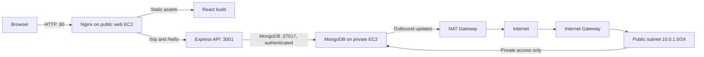

# TravelMemory AWS Deployment Report

- **Verification date:** 2026-10-26
- **Region:** `us-east-1`
- **Deployment status:** Fresh MongoDB credentials are verified, the API/web health checks pass, and two demo trips were created and read back successfully.

## Summary

TravelMemory is deployed on AWS using Terraform for infrastructure and Ansible for host configuration. The public web host serves the React build through Nginx and runs the Express API as a systemd service. MongoDB runs on a separate private EC2 host.

The public web host is currently `44.200.207.5`. A fresh MongoDB data directory was initialized, new administrator and app-user credentials were provisioned, and both database-local and web-host authentication checks passed. The previous MongoDB data directory was retained on the database instance at `/var/lib/mongo.pre-reset.20261025T191051Z` for rollback. The local backend source was deployed because it reads the separately configured MongoDB credentials. The production frontend uses same-origin API paths, avoiding an embedded ephemeral public IP.

## Architecture

Terraform provisions a `10.0.0.0/16` VPC with public and private `/24` subnets, an Internet Gateway, a NAT Gateway, route tables, security groups, IAM instance roles/profiles, and two Amazon Linux 2023 `t3.micro` EC2 instances. The web instance is in the public subnet; the database instance has no public IP and uses the NAT Gateway only for outbound access.

The web security group allows HTTP/HTTPS from the internet and restricts SSH to the configured operator CIDR. The database security group allows MongoDB and SSH only from the web security group. The host configuration also enables `firewalld`, disables root/password SSH login, and runs the API as a dedicated service account. See [Terraform configuration](../terraform/main.tf) and the [Terraform deployment guide](../terraform/README.md).

## Application Request Flow

Nginx serves the React build from `/var/www/travelmemory`. Requests to `/trip` and `/hello` are proxied to Express on `127.0.0.1:3001`; port 3001 is not exposed publicly. Express queries MongoDB at the private database address. MongoDB authentication is enabled, with the application user intended to receive `readWrite` access only to the `travelmemory` database. Ansible renders the API environment file and systemd service, installs MongoDB/Node.js/Nginx, and builds the frontend on the control machine to avoid exhausting memory on the small web instance. See the [Ansible playbook](../ansible/site.yml) and [Ansible deployment guide](../ansible/README.md).

## Deployment Procedure

1. Configure AWS CLI credentials for the target account and region.
2. Set `terraform/terraform.tfvars` with the EC2 key-pair name and an operator SSH CIDR, preferably a single-address `/32`. This file and Terraform state are local and must not be committed.
3. Run Terraform initialization, validation, plan review, and apply from `terraform/`.
4. Set `ANSIBLE_PRIVATE_KEY_FILE` to the matching EC2 private key and run `bash ansible/deploy.sh` from the repository root.
5. At the Ansible prompts, enter and confirm the MongoDB administrator and application-user passwords. Keep them in a password manager; they are not stored in the repository.
6. Verify the current EC2 address and check the web/API/database services after deployment.

## Verification Results

| Check | Result |
|---|---|
| AWS EC2 state | Both Terraform-tracked instances are `running` in `us-east-1`. |
| Current web host | Public IP `44.200.207.5`; private IP `10.0.1.65`. |
| Database host | Private IP `10.0.2.254`; no public IP is assigned. |
| MongoDB data | Fresh database contains the two demo trips below; prior data directory is retained on-instance at `/var/lib/mongo.pre-reset.20261025T191051Z`. |
| MongoDB app authentication | Ansible local and web-host app-user authentication and `ping` preflights passed. |
| `GET /` | HTTP 200; React home view displays both demo trips. |
| `GET /hello` | HTTP 200 with `Hello World!`. |
| `GET /trip/` | HTTP 200 with a JSON array containing 2 trips. |
| `POST /trip` | Both demo submissions returned HTTP 200 with `Trip added Successfully`. |
| Trip details | `GET /trip/:id` returned the Kyoto demo entry and its details page rendered. |
| API and Nginx | Both `travelmemory-api` and `nginx` report active. |

The two entries are synthetic demo data added after the database reset: `Demo - Kyoto Spring 2025` (featured) and `Demo - Lisbon Weekend 2025`.

## Visual Evidence

- [Add Experience form](evidence/add-experience.png): the form used to create the demo records; both POST results are listed in the verification table.
- [Home page with demo trips](evidence/home-with-demo-trips.png): both featured and regular trip cards render from MongoDB.
- [Demo trip details](evidence/trip-details-demo.png): details loaded by trip ID from MongoDB.
- [Fresh empty home page](evidence/home-fresh-empty.png): captured immediately after the database reset, before adding demo records.

## Limitations and Follow-up

- **Demo data:** the active database contains only the two synthetic verification trips; replace or remove them before presenting the app as user data.
- **Preserve rollback data:** the previous database files remain on the same EC2 volume; they are not an off-instance backup. Do not remove them until the fresh deployment is accepted.
- **Avoid source drift:** the playbook currently copies the workspace backend after cloning GitHub `main`; commit/push the intended backend changes before treating GitHub as the sole deployment source.
- **TLS:** the site is HTTP-only. There is no domain or TLS certificate configured; the security group permits 443, but the current Nginx site listens on port 80 only.
- **Dependency audit:** the frontend install reported 103 npm audit findings, including 5 critical findings. Create React App and ESLint also reported warnings; review and remediate before production use.
- **AWS cost:** the NAT Gateway and two EC2 instances remain billable until the Terraform resources are destroyed.
